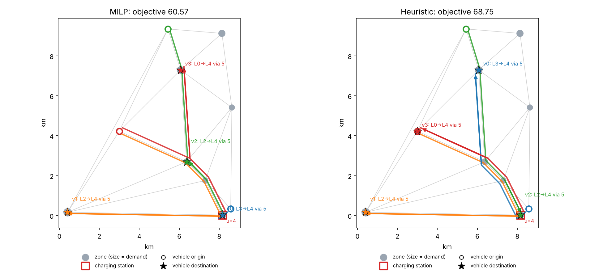

# CHARGE-UP

**C**arshare **H**ierarchical **A**llocation and **R**ebalancing with **G**raph-**E**xpanded charging, **U**sing **P**-median

CHARGE-UP is a Python implementation of a non-myopic fleet management algorithm for electric mobility-on-demand (MOD) services. It decides where to reposition idle electric vehicles and how much to charge them when charging stations have limited capacity. It was proposed in:

> Pantelidis, T.P., Li, L., Ma, T.-Y., Chow, J.Y.J., & Jabari, S.E.G. (2022). A Node-Charge Graph-Based Online Carshare Rebalancing Policy with Capacitated Electric Charging. *Transportation Science* 56(3), 654–676. https://doi.org/10.1287/trsc.2021.1058

The paper tests the method on a one-way carsharing fleet, but the formulation applies to any MOD fleet whose idle vehicles must be repositioned and recharged to serve uncertain, spatially distributed demand. Examples include ride-hailing, robotaxi, microtransit and carsharing services.

At each rebalancing interval the operator decides where to send each idle vehicle and how much to charge it. The policy is a cost function approximation (CFA): a *p*-median relocation model on a **node-charge graph**. Each zone is copied once per discrete charge level. Vehicles move between zones within a level and move up a level by using a charger. The model includes:

- **Access cost.** A request in one zone can be served by a vehicle in another zone, as long as the vehicle has at least the charge level the trip needs. Depending on the service, this cost is the customer's walk to the vehicle or the vehicle's pickup trip to the customer.
- **Queueing-based reliability** (Marianov & ReVelle, 1996). This anticipates stochastic demand, which makes the policy non-myopic.
- **Charging-station capacity**, counted as charging *paths* through each station rather than as flow on individual links.
- **Minimum-cost-flow routing** of the relocated vehicles.

Please refer to the paper for the full methodology, the online simulation and the case study (a one-way carsharing fleet in Brooklyn, based on BMW ReachNow data). This repository has the single-interval optimization that the policy solves at each rebalancing step.

The code is written in Python (≥ 3.9) and needs only NumPy and SciPy. The exact model is solved with the open-source HiGHS solver that ships with SciPy, so no commercial solver license is needed. Matplotlib is optional and only used for plotting.

## What is included

| Component | Paper | Function |
|---|---|---|
| Queueing thresholds ρ<sub>m</sub> | Eq. (19) | `nodecharge.rho_threshold`, `rho_table` |
| Node-charge graph and problem data | §3.2.1 | `nodecharge.Instance` |
| Exact route-capacitated min-cost-flow relocation MILP | Eqs. (3)–(18) | `nodecharge.solve_milp` |
| Greedy heuristic | Algorithm 1 | `nodecharge.solve_heuristic` |
| Myopic benchmark (Constraint 7 relaxed) | §5 | `queueing=False` in either solver |
| Feasibility checker for Constraints (4)–(18) | — | `nodecharge.check_solution` |
| Random instance generator (Table 1 settings) | §4.2 | `nodecharge.random_instance` |

## Installation

```bash
git clone https://github.com/BUILTNYU/CHARGE-UP.git
cd CHARGE-UP
pip install -r requirements.txt          # numpy, scipy (+ matplotlib for plots)
```

The Python package itself is imported as `nodecharge`. You can also install it with `pip install .`, which registers it under the name `charge-up`.

## Quick start

```python
from nodecharge import random_instance, solve_milp, solve_heuristic, check_solution

inst = random_instance(n_zones=10, n_levels=5, seed=0)   # Table 1 settings
exact = solve_milp(inst)                                  # Eqs. (3)-(18), HiGHS
heur = solve_heuristic(inst)                              # Algorithm 1

print(heur.summary(inst))
assert check_solution(inst, heur) == []                   # all constraints satisfied
print("gap: %.1f%%" % (100 * (heur.objective / exact.objective - 1)))
```

### Using your own data

```python
import numpy as np
from nodecharge import Instance, solve_heuristic

inst = Instance(
    n_zones=6, n_levels=4,
    edges=[(0, 1, 5.0), (1, 2, 5.0), (2, 3, 5.0), (3, 4, 5.0), (4, 5, 5.0)],  # (i, j, travel time)
    lam=np.random.rand(6, 4),      # lam[i, g]: arrivals at zone i needing charge level >= g
    mu=30.0,                       # service rate per vehicle (scalar or (N, H) array)
    stations={1: 2, 5: 2},         # charging station zone -> number of chargers u_j
    vehicles=[(0, 1), (2, 0), (4, 3)],   # idle vehicles: (zone, charge level)
    charge_time=25.0,              # cost of charging one level
    theta=0.02, C=3, eta=0.95, b=0,
)
sol = solve_heuristic(inst)
for f, route in enumerate(sol.routes):    # node-charge path of each vehicle
    print(f, route, "charges at", sol.charging_station(f))
```

Indices are 0-based. Zones are `0..N-1` and charge levels are `0..H-1`, where level `h` means "at least the (h+1)-th charge band" (e.g. with H = 4, level 0 = 20%+ and level 3 = 80%+). A vehicle at level `h` can serve any request that needs level `g ≤ h`.

**Inputs**

- Zone network: undirected links with travel times. Access costs τ<sub>ij</sub> and relocation costs come from the shortest paths in this network.
- Demand λ<sub>ig</sub> by zone and minimum charge level, and the service rate μ<sub>jh</sub>.
- Charging stations J with capacities u<sub>j</sub>, and the charging time per level.
- Current locations and charge levels of the idle vehicles.
- Parameters θ (weight of rebalancing cost), C (maximum number of servers per node-charge), and η and b (queueing reliability and allowed queue length).

**Outputs** (`Solution`)

- `routes`: the node-charge path of each vehicle, including where it charges.
- `assignment`: which vehicle location covers each demand node-charge (X<sub>igjh</sub>).
- `access_cost`, `rebalancing_cost`, `objective`, `runtime`, `status`.

## Test case

`examples/random_instance.py` solves one rebalancing interval on a random 10-zone, 5-level instance with the settings in Table 1 of the paper:

- B = 0.4|N| = 4 idle vehicles and |J| = 0.1|N| = 1 charging station with u<sub>j</sub> = B/|J|
- λ ~ U[0,1], θ = 0.02, C = 3, η = 0.95, b = 0 (which gives ρ = 0.2236, 0.6416, 1.1576, as in Table 1)
- μ = 1.5 Σλ

```bash
python examples/random_instance.py --plot
```

```
[MILP] status=... Optimal  objective=60.5735  (access=57.7614, rebalancing=140.605 x theta=0.02)
  vehicle 0: zone 6, level 3 -> zone 5, level 4 (charges at station 5: level 3 -> 4)
  vehicle 1: zone 9, level 2 -> zone 1, level 4 (charges at station 5: level 2 -> 4)
  vehicle 2: zone 4, level 2 -> zone 0, level 4 (charges at station 5: level 2 -> 4)
  vehicle 3: zone 9, level 0 -> zone 3, level 4 (charges at station 5: level 0 -> 4)
[Heuristic] status=feasible  objective=68.7480  ...
[MILP (myopic)] ... objective=58.5227 ...
Heuristic optimality gap: 13.50%
```



The paper does not specify the network geometry for its random instances. Here zones are placed at random in a 10 km square and connected by a Delaunay triangulation, with travel at 30 km/h, and charging takes 6 minutes per level.

### Scalability (cf. Table 2 of the paper)

`python examples/benchmark.py --sizes 10 20 50 100 --reps 5` gives, on a cloud Linux VM (mean of 5 random instances per size):

| N | H | N × H | MILP (s) | Heuristic gap (%) | Heuristic (s) |
|---:|---:|---:|---:|---:|---:|
| 10 | 5 | 50 | 0.62 | 12.1 | 0.01 |
| 20 | 5 | 100 | 0.23 | 16.4 | 0.05 |
| 50 | 5 | 250 | 8.34 | 11.4 | 0.28 |
| 100 | 5 | 500 | 9.42 | 10.2 | 1.27 |

These gaps are in the same range as the 7–35% reported in the paper. Exact timings depend on the hardware and on the solver (HiGHS here, MATLAB `intlinprog` in the paper).

### Unit tests

```bash
pip install pytest
pytest
```

The tests check:

- the ρ values in Table 1;
- small hand-made cases where the optimal decision is known (forced charging, a binding station capacity, and queueing that requires two vehicles in one zone);
- path counting for Constraints (13)–(14);
- the myopic fallback;
- on random instances, that both solvers return feasible solutions with heuristic ≥ MILP ≥ myopic MILP.

## Implementation notes

The MILP follows Eqs. (3)–(18), with these choices:

- Coverage (4) is required for every demand node-charge with λ > 0.
- Constraints (10)–(11) are implied by flow conservation (12), so they are not added.
- Arc flows W are declared integer so that routes are always integral.
- `relax_Y=True` treats the server variables as continuous, as suggested in Sayarshad & Chow (2017), which is faster.

The pseudo-code of Algorithm 1 leaves some details open. This implementation resolves them as follows (see the docstring of `nodecharge/heuristic.py` for details):

- **Initialization (Steps 14–15).** All vehicles are first placed virtually at the 1-median zone, at the highest charge level that has demand. One location pooling all vehicles has the most queueing capacity, so if this start is infeasible, the MILP is too.
- **Savings (Steps 3–13).** The saving of a candidate node-charge (i, g) is the Teitz–Bart access-cost saving over demand at levels ≤ g, scaled by the share of the attracted demand d1 that one more server can absorb, d2 = μ(ρ<sub>n+1</sub> − ρ<sub>n</sub>). The θ-weighted relocation cost is then subtracted.
- **Feasibility (Steps 17–18).** A candidate is skipped if it would violate (7) or coverage (the set N<sup>M</sup>), exceed C servers, or need a charger when none is free.
- **Station capacity (Step 20).** Charging capacity is tracked per station rather than fleet-wide, so every heuristic solution satisfies (14).
- **Exact re-scoring.** `n_eval` (default 10) re-scores the best feasible candidates by savings using their exact objective after reassignment (Step 21). `n_eval=1` is the pure savings rule. Larger values improve quality at some extra run time.
- **Vehicle order.** `vehicle_order="best"` (default) moves the vehicle with the largest savings at each iteration. `"index"` processes vehicles in the given order.
- **Myopic fallback.** If no queueing-feasible solution is found, the heuristic re-runs with (7) relaxed (the myopic policy), as recommended in §3.3. `Solution.status` reports when this happens.

## Repository structure

```
nodecharge/
  instance.py     problem data, node-charge graph, random instance generator
  queueing.py     rho thresholds from Eq. (19)
  milp.py         exact model, Eqs. (3)-(18), solved with SciPy/HiGHS
  heuristic.py    greedy heuristic (Algorithm 1)
  solution.py     Solution class, objective evaluation, feasibility checker
  plot.py         optional matplotlib plot of a solution
examples/
  random_instance.py   small test case (one rebalancing interval)
  benchmark.py         scalability test against the exact MILP
tests/
  test_nodecharge.py
```

## Citation

If you use CHARGE-UP, please cite the paper:

```bibtex
@article{pantelidis2022nodecharge,
  title   = {A Node-Charge Graph-Based Online Carshare Rebalancing Policy with Capacitated Electric Charging},
  author  = {Pantelidis, Theodoros P. and Li, Li and Ma, Tai-Yu and Chow, Joseph Y. J. and Jabari, Saif Eddin G.},
  journal = {Transportation Science},
  volume  = {56},
  number  = {3},
  pages   = {654--676},
  year    = {2022},
  doi     = {10.1287/trsc.2021.1058}
}
```

The original MATLAB test instances and simulator are on Zenodo (Chow, 2019), as cited in the paper.

## License

Released under the NYU Non-Commercial Research License. See [LICENSE.md](LICENSE.md). For commercial licensing, contact the NYU Office of Industrial Liaison.

Developed at [BUILT@NYU](https://github.com/BUILTNYU), New York University.
